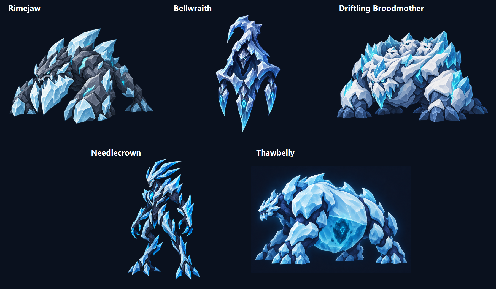
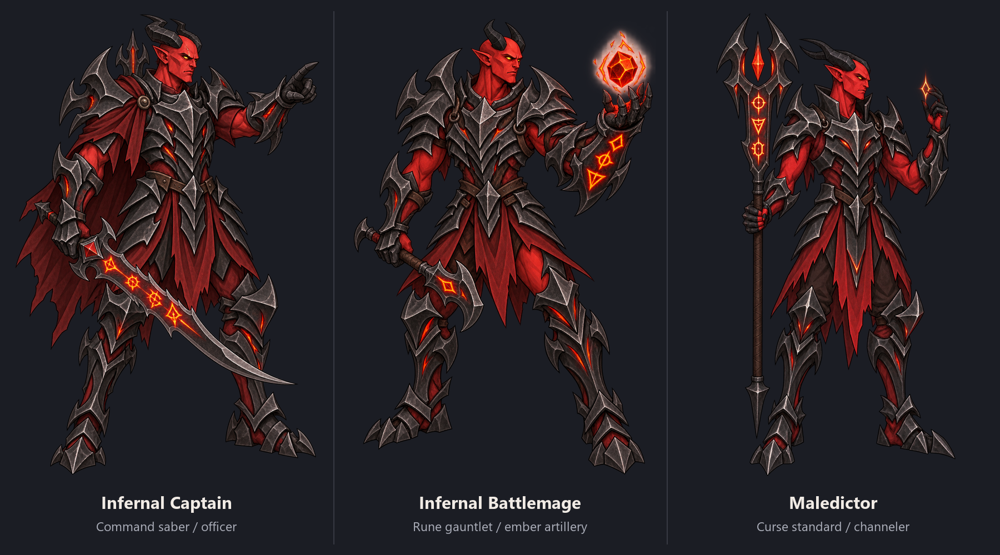
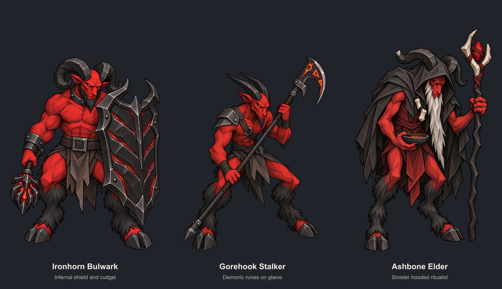
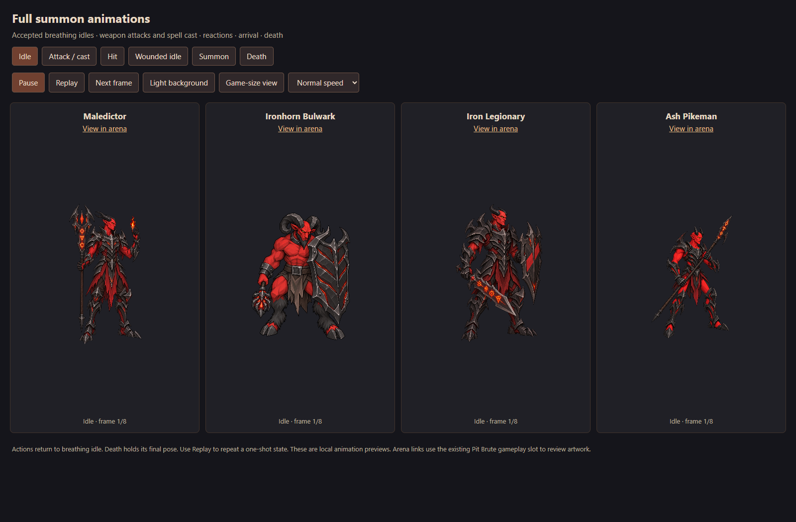

# New assets — Runelord work recovered from this machine

Collected October 12, 2026 for `wiltobuild/runelord`. This is a preservation and handoff archive of the Runelord work found in this machine's local chats and their files. It preserves concepts, revisions, source sheets, exported frames, animation previews, generation prompts, build scripts, production packets and historical QA. **It does not automatically install or approve these assets in the game.**

Start with [what each asset is and how it was made](MAKING-OF.md), then use the [complete bundle index](BUNDLE-INDEX.md) for every revision and its technical metadata. [Coverage and unresolved items](COVERAGE.md) explains what was recoverable.

## Browse the collection

| Folder / record | Contents |
|---|---|
| [Summon artwork and animation](summons/assets) | All 1,050 files from the summon chat's output folder, including the original ZIP deliveries, earlier revisions, final previews, source sheets and metadata |
| [Summon making-of files](summons/making-of) | Exporters, compositors, mask/registration repairs, review scripts, screenshots and historical QA reports |
| [Ice monsters and Infernal Plane](ice-and-map/assets) | Five ice concepts, overview, creative brief and labeled 21-point map image |
| [Generation originals](generation-originals) | Original generated images recovered from paths referenced by the relevant chats and their own image folders; includes experiments and rejected directions |
| [Generation call records](generation-call-records.json) | 82 recovered image-generator invocations with the source chat and recorded time; additional prompts live beside the output assets |
| [Production evidence](production-evidence) | Uncommitted gallery submissions, sidecar metadata, work packets, and the existing approval ledger/workflow snapshot |
| [Chat notes](chat-notes) | Deduplicated user direction and recorded results from the four local Runelord chats |
| [File manifest](file-manifest.json) | Source identity, archive path, byte size and SHA-256 for every copied source file |

## Quick previews

### Ice family

### Demon command and casters

### Revised goatmen

### Full summon review

## How to use the archive

Use the later accepted-direction candidates identified in `MAKING-OF.md` as starting points. Read each bundle's `animation.json` before importing: canvases, anchors and state timings vary. Keep the source sheets and generation provenance beside your chosen exports. Earlier versions and rejected concepts are historical evidence, not recommended replacements.

The scripts preserve their original paths and dependencies, chiefly Python/Pillow/NumPy and Node/browser tooling. They are historical making-of sources, not a portable one-command rebuild. Remap their original workspace roots to this archive before executing them. Generated imagery is not deterministic: the prompts and references document the process but do not guarantee identical regenerated pixels. Exported PNGs and their hashes preserve the exact result.

The original working repository was at `be1dc8c85d04dbf335352a212cd1d16efedf0700`. Only this new folder is added by the archive commit. Runtime previews that previously existed at localhost addresses require the original preview setup and may not work by opening a saved HTML file directly.
