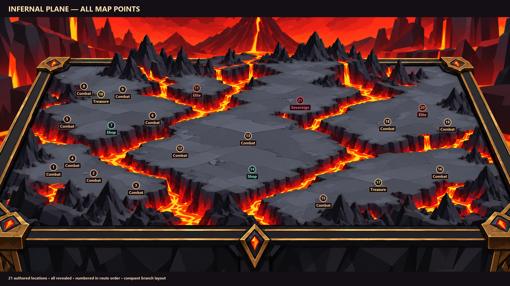

# Spawn RuneLord agents

Historical discussion extracts from local session records. Repeated fork history is deduplicated. Results below are historical claims, not newly certified tests. Some worker summaries share the parent chat identity; ordering is by recovered record, not a guaranteed timeline. Localhost URLs were temporary previews.

### User direction

spawn the runelord agents here

### Recorded result

Runelord Game QA agent is ready for follow-up as an independent reviewer. Shell initialization failed with a setup refresh error, so I could not read the role configuration or project instructions. No files changed or testing started.

### Recorded result

Checklist sent: five distinct silhouettes, clear ice/snow materials, one focal feature per monster, varied proportions, readable faces and limbs, and differences that survive grayscale. Ready to review the creative brief; artwork QA awaits actual images.

### Recorded result

Main refinement: separate Broodmother’s low, wide snow-basin silhouette from Thawbelly’s elevated barrel body and hanging belly. Use angular brood, stern faces, and crisp flat transparency to prevent cute or rendered-material drift. Simplify Bellwraith’s dangling shards and Needlecrown’s crown; preserve Rimejaw’s visible split jaw.

Concept preflight complete; artwork QA awaits generated images.

### Recorded result

Ready to inspect all five final images for left-facing orientation, full-body framing, distinct designs, and consistent cel-shaded style.

### Recorded result

Inspected all five images. Bodies are complete and designs distinguishable. Four read leftward; Bellwraith remains essentially frontal and is provisional.

Style is cohesive and serious, though more densely faceted and glowy than the brief. Broodmother reads as armored ice rather than snow; Needlecrown has long arms. No files changed.

### Recorded result

Runelord Technical Artist initialized and available. Shell access failed with a setup refresh error, so I couldn’t read the role configuration or project instructions. No files changed or implementation started.

### Recorded result

Verified and visually inspected two approved references:

- `C:/Users/Wil/Documents/Codex/2026-10-09/i-x20/runelord/assets/characters/pleatcap-matriarch/base-r1.png`  
  SHA256 `bd6a80873622abe3ddf062abf86786928c1fd36a62cb936f6fd8f3502fe1f987`
- `C:/Users/Wil/Documents/Codex/2026-10-09/i-x20/runelord/assets/heroes/references/warlock/warlock-base-r1.png`  
  SHA256 `3585512c985b250f1da8a159f436e82dc673059269bd1e54cfad625b01e28f02`

Both hashes have **Approved** ledger decisions.

Style: serious angular 2D cel shading; broad flat planes, sharply cut geometric shadows, minimal contour strokes, strong silhouettes, stylized proportions, chunky forms and restrained detail. No painterly texture, soft rendering, realistic materials, excessive glow, or cute mascot proportions. For ice, use solid pale-blue planes and deep blue shadows instead of photoreal transparent glass.

Read AGENTS.md, art workflow, production workflow and role instructions. No files modified. Source revision `be1dc8c85d04dbf335352a212cd1d16efedf0700`.

### Recorded result

Three newer references verified and visually inspected. Paths are relative to `C:/Users/Wil/Documents/Codex/2026-10-09/i-x20/runelord/`.

| Reference | Recency | SHA256 |
|---|---|---|
| `assets/characters/forest-sovereign/animations/frames32-r1/frames/idle-00.png` | Oct 5, commit `f986284`; current forest finale | `486576e989c8b0f002ca6f77ad48af5fa15e88514e9b0b9ef2e379b742d81909` |
| `assets/characters/warlock-gorthak/animations/idle-review-r3/frame-00.png` | Oct 5, commit `a736915`; latest requested in-game idle | `456914cbc23bc750db1ac4701b5c53875547c84a1b03ff78616e1fac0bea33b5` |
| `assets/heroes/animations/abyssal-seraph/frames32-r2/source/master.png` | Oct 3, commit `a1ef979`; replacement hero | `8cbd77e13301c7b34f72a1560e8e537bcbc5eb593b46b66340c3896ee0856aec` |

Current visual direction: dimensional, muscular 2D fantasy forms; angular cel shadows combined with curved organic silhouettes; strong material separation; layered armor/bark/foliage; deeper shadows and selective bright highlights. Gorthak is broad and massive with oversized fists. Forest Sovereign uses overlapping bark plates and foliage masses. Seraph adds finer facets, thin dark contours, sharper ornamental edges, and dramatic saturation.

These are substantially richer than the retired references. Use Forest Sovereign and Gorthak for monster rendering, with Seraph as a secondary sophistication reference.

**Status accuracy:** all three exact hashes are absent from the gallery ledger. Forest and Gorthak records explicitly authorize runtime integration while retaining pending art status. Seraph is current runtime art; no exact-hash gallery approval was established. No files modified.

### Recorded result

Runelord Producer is spawned and available. Shell access failed with a setup refresh error, so I couldn’t read the role configuration or workflow instructions. No files were changed and no backlog work was started.

### Recorded result

Five original concepts, with rendering treatment left open until Runelord’s style references are verified:

1. **Rimejaw** — A low, heavy ambush beast with oversized forelimbs and a split ice shovel for a lower jaw. Frosted stone hide, translucent jaw edges, and a territorial temperament. **Combat hook:** plows a straight snow trench, then snaps upward; a visibly lodged jaw creates its vulnerable moment.

2. **Bellwraith** — A floating, hollow icicle bell with dangling shards and a small dark face suspended inside. Thin glassy ice and trapped drifting snow give it a mournful, curious personality. **Combat hook:** rings expanding frost circles; its dangling shards signal the next pulse.

3. **Driftling Broodmother** — A squat, broad snow creature carrying a cluster of tiny snowlings in a bowl-shaped back. Packed snow, pebble features, and iced-over patches; fiercely protective with bustling, fussy movements. **Combat hook:** shakes off snowlings that assemble into a temporary barricade.

4. **Needlecrown** — A tall, narrow, two-legged predator with a fan of backward-pointing ice spines and tiny folded arms. Dense blue ice around a dark mineral core; vain, precise, and unnervingly still. **Combat hook:** tilts its crown to telegraph a directional shard volley, briefly exposing its core.

5. **Thawbelly** — A round, top-heavy creature on four short feet, with a transparent frozen belly containing sloshing water and a suspended heart-stone. Cloudy ice plates and watery innards; sleepy until disturbed, then petulant. **Combat hook:** rocks to build momentum before belly-sliding, leaving a slick trail and becoming dizzy on impact.

### Recorded result

Spawned here:

- Runelord Producer
- Runelord Technical Artist
- Runelord Game QA

All three worker slots are filled. Repository initialization is currently limited by a shell setup error; the agents are available for follow-up.

### User direction

use them to make 5 different ice monster concepts in our artstyle

### User direction

the two examples you picked are like some of the oldest models, we dont even use that warlock anymore. look at more recent examples and use them for a refrence for artstyle

### User direction

there all facing the wrong direction, you clan flip them for now but make sure to make the rest facing the right way for combat

### Recorded result

Flipped the four existing concepts; Thawbelly was generated facing left. Future combat artwork will use an explicit left-facing pose. Bellwraith remains mostly frontal for now.

[Full-size concepts and brief](C:/Users/Wil/Documents/Codex/2026-10-09/sp/outputs)

### User direction

show me the infernal plane map with all the points visable

### Recorded result

Here’s the Infernal Plane with all **21 map points** labeled from the conquest-branch layout.

[Open full resolution](../ice-and-map/assets/infernal-plane-all-points.png)

### User direction

can you show me in engine, just load up the game

### Recorded result

The game is running: [Open Runelord](http://127.0.0.1:4320/).

This launches the current roguelike build; the Infernal map belongs to the separate conquest build.

### User direction

this is the roguelike build there no infernal map

### Recorded result

You’re right; that was my mistake. I checked the latest Conquer Mode branch, but its map-screen files are missing from this checkout and Git history, so it cannot launch as-is.

I’ve asked where the working build is so I can open the actual map.