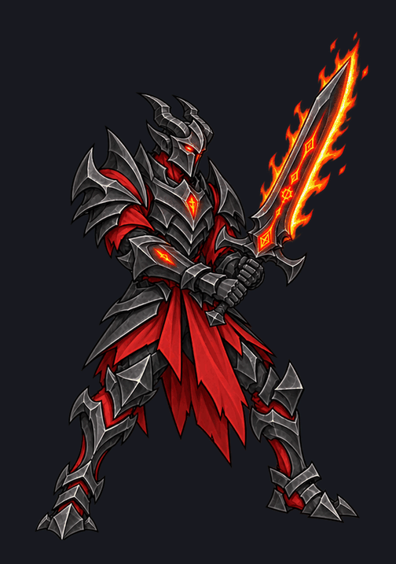

# Create five new demon summons (2)

Historical discussion extracts from local session records. Repeated fork history is deduplicated. Results below are historical claims, not newly certified tests. Some worker summaries share the parent chat identity; ordering is by recovered record, not a guaranteed timeline. Localhost URLs were temporary previews.

### Recorded result

Added four body poses with subtle head, claw, and leg movement over the existing eight wing frames. The game preview is updated, and both earlier versions are preserved.

### User direction

the left leg moves around too much, help the frames with some subtle floating animations

### Recorded result

Steadied the legs and added a gentle floating bob, keeping the wingbeat and subtle upper-body motion. Preview updated; previous versions are saved.

### User direction

looks good, give it the other animation states.  at the same time start on some new summon samples. Lets some goatmen concepts in this style,  and lets do some standard demon soldiers.

### User direction

demon soldiers look too refined.  lets try to make the armor look a little more demonic, and aggressive. they should have weapons with glowing demonic runes.

### Recorded result

Both soldiers now have jagged, hooked armor and glowing infernal weapon runes. Previous versions are saved.

The Imp’s attack, hit, wounded hover, summon, and death previews are also ready in the [animation viewer](http://127.0.0.1:4321/imp-animation-review?revision=soldiers-r2).

### User direction

the new demon soldiers look good, give me a Captain demon soldier, and some caster demon soldiers concepts. Also the goat men are good give me 3 more to expand out the family

### Recorded result

Six new concepts, matching the families you approved.

**Demon soldiers:** Infernal Captain, Infernal Battlemage, and Maledictor curse caster.

**Goatmen:** Ironhorn Bulwark, Gorehook Stalker, and Ashbone Elder.

### User direction

for the captain get rid of the thing in between his head and shoulder plate on the left, and just adding cloth doesnt really make him feel like a captain, lets try more elite armor and a helmet. The maledictor is good. the bulwarks weapon and shield should look more demonic, have the shborne elder wearing a hood and look more sinster and formitable. the stalker should have demonic runes on the weapon. do a couple demonic soldier casters that are only wearing demonic robes.

### Recorded result

Updated the captain with elite armor and a helmet, removed the unwanted ornament, and added two robe-only casters.

The Bulwark has demonic equipment, the Stalker has glowing weapon runes, and the Elder has a sinister hooded silhouette. Maledictor and earlier versions are preserved.

### User direction

give me a few varints of the ember ritualist. Want te robes to look a bit more demoic and sinister, sa,e for the hex.  Give me some alternate concepts for the infernal captain, make sure it has darker armor

### Recorded result

Made three variants for each, with the originals preserved.

**Ember Ritualist — sinister hoods, hanging sleeves, and ritual cloth.**

**Hex Votary — demonic cowls, veils, and rune-covered shrouds.**

**Infernal Captain — darker armor and three alternate silhouettes.**

### User direction

show me what the dread vanguard would be battle stanced, 8 frame idle animation where the runes and eyes glow and flicker in intensity.

### Recorded result

Eight-frame battle idle with independently flickering eyes and runes, plus a slight sway while his feet stay planted.

[Download frames and animation](../summons/assets/dread-vanguard-idle-r1.zip)

### User direction

show me in the game as a summon

### Recorded result

Opened the [live summon preview](http://127.0.0.1:4321/summon-review?units=imp,hellhound,pit-brute&vanguard=idle-r1) with his animated rune and eye flicker. He temporarily uses the Pit Brute’s gameplay slot.

### User direction

the idle animation needs more movement. The glowing effects are too subtle, they should read more like fire. Also make the blade glowing on its edge

### Recorded result

Added stronger guard movement, fiery rune and eye flicker, and flames along the blade’s glowing edge. The game preview is updated; the previous version is saved.

### User direction

third frame moves too much, fix it

### Recorded result

Softened the third frame and its return in the loop. Feet stay planted, the fire remains, and the game preview is updated.

### User direction

um why is the fire not moving?

### Recorded result

Because I reused one pose with the flames already painted onto it and only varied their brightness. That makes the fire pulse, but its shape stays frozen. I should have animated the flame shapes separately when fixing the body movement.

### User direction

yeah you should have, fix it

### Recorded result

Fixed: the flames now curl and change shape across all eight frames, while the corrected body movement stays intact. The game preview is updated.

### User direction

needs to be a bit bigger in game. lets try 30%

### Recorded result

He’s now 30% larger in the live game preview, with the animation unchanged.

### User direction

liitle bit bigger

### Recorded result

Added another 10%—he’s now 43% larger than the original. Preview updated.

### User direction

perfect, lets give him his different animation states that he doesnt have, the breathing will be the idle stance. give him all the other ones a summon will need

### Recorded result

Completed hit, block, and wounded idle at `outputs/dread-vanguard-states-r1/`.

- Hit: 6 frames, 580 ms, returns to approved idle.
- Block: 6 frames, 650 ms, returns to approved idle.
- Wounded idle: 8 frames, 1280 ms loop; two authored body poses.
- All frames: 1200×1100, anchor `[600,1020]`, independently moving fire, no canvas-edge clipping.
- GIFs, WebPs, contacts, sources, prompts, and manifests saved. All six review previews submitted as pending.

Wounded body motion is stepped between two poses; foot spread varies slightly from normal idle. Originals preserved.

### Recorded result

Spawn and death pass independent preview review: no clipping, consistent grounding, readable transitions, and suitable endpoints. Death ends with an extinguished blade and stable corpse hold.

Both use five distinct keyposes, so motion is deliberately stepped; spawn’s initial sword-angle change is brisk.

### Recorded result

Completed arrival and death in `outputs/dread-vanguard-states-r1/spawn` and `/die`.

- Arrival: 5 frames, 880 ms, ends at approved idle.
- Death: 5 frames, 1,420 ms, holds extinguished collapsed pose.
- Both: 1200×1100, anchor `[600,1020]`, fixed anatomical scale, transparent PNGs, GIF, contact sheet, metadata and generation provenance.
- Submitted GIFs and pose sheets to gallery as pending.
- No shared integration files changed. Parent should pad each frame by `[300,60]` for final 1800×1200 canvas.

Inspected contact sheets; no clipping. Four authored poses per state produce deliberately stepped transitions.

### Recorded result

Blocking issue: `runtime/attack/frame-03.png` clips the fire at the right canvas edge (`x=1800`). Attack frames 02–03 also contain detached fire fragments below the sword; feet remain correctly registered near y1080.

Other reviewed states pass this visual/structural check:

- Cast, hit, block, wounded idle: no clipping, consistent canvas and comparable anatomical scale.
- Attack/cast: exact approved-idle start/end.
- Hit/block: recover into existing idle variants.
- Wounded idle: approximately 3px foot variation, acceptable for breathing.
- Runtime timing entries are ordered and remain within state durations.

No files edited.

### Recorded result

Recheck passed. Attack frames 02–03 retain complete sword/fire silhouettes and no longer contain detached bottom fragments. Frame 03 has 92px right clearance; feet remain near y1080. No remaining blocking issue in the reviewed states.

### Recorded result

Added cleave, cast/command, hit, block, wounded idle, summon arrival, and death. His approved breathing idle and size are preserved.

[Preview all animations](http://127.0.0.1:4321/vanguard-animation-review) · [See him in battle](http://127.0.0.1:4321/summon-review?units=imp,hellhound,pit-brute&vanguard=states-r1)

Checked clipping, transitions, and battle playback.

### User direction

his sizing his all over the [place on the other animations, when he dies he also looks likes hes floating.

### Recorded result

Corrected the action poses’ scale against the approved idle and grounded the death pose, with the sword lying flat beside him. Idle is unchanged; the previous version is saved.

[View the corrected animations](http://127.0.0.1:4321/vanguard-animation-review?revision=states-r2)